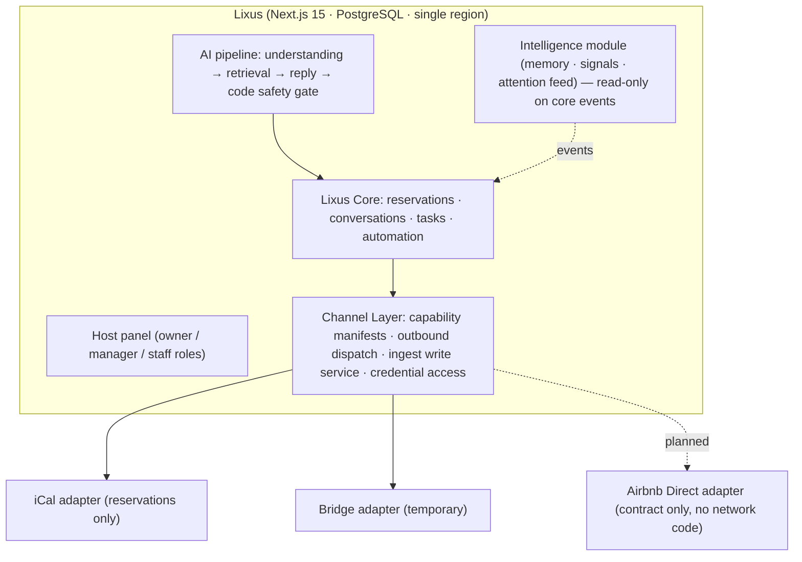
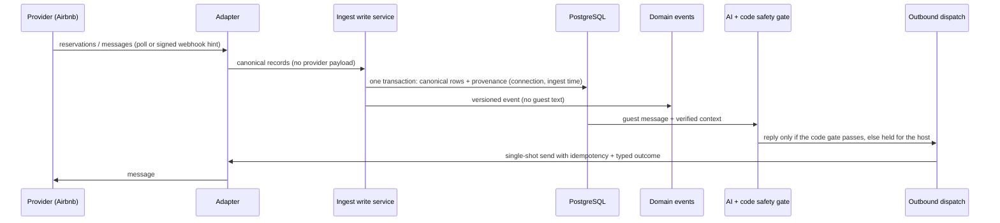

# Lixus AI — Airbnb API integration dossier (DRAFT)

> **İÇ NOT — Airbnb'ye gidecek dış sürümde bu blok, iç belge yolları ve [TBD] satırları ÇIKARILIR.** Talimat 09-07 "Airbnb başvurusu öncesi 6 kapı"nın 6. kapısı. Airbnb'ye gidecek metin olduğu için
> İngilizce. Her teknik iddia kodda doğrulandı (yol verildi); **[TBD]** işaretli yerler canlı veri / kurucu kararı ister ve
> doldurulmadan gönderilmez. Kurucu kararı 09-23: başvuru yakında yapılmayacak — bu taslak hazır beklesin.
> İnceleme 10-09 (Haiku olgu denetimi): yanlış / abartılı iddialar düzeltildi. Kaynak belgeler: `docs/GUVENLIK-KONTROLLERI-2026-09-28.md` (güvenlik envanteri, Türkçe), `docs/AIRBNB-DIRECT-SOZLESMESI.md`,
> `src/lib/channels/requirements.ts`, `docs/saklama-ve-imha-politikasi.md`, `docs/YOL-PLANI-DURUM-2026-10-09.md`.

Status: draft, 2026-10-09. Certifications: **none** (no SOC 2 / ISO 27001 / independent penetration test yet). Everything below
is a control verified in source code, not an audit report.

## 1. Company and product

- **Product:** Lixus AI (lixusai.com) — a multi-tenant, AI-native property-management and operations system for short-term
  rental hosts, Türkiye first (Turkish-first UI; replies in the guest's language).
- **Positioning:** not an AI layer on top of another PMS. Lixus owns its domain model (properties, reservations, conversations,
  messages, tasks, property memory) and connects to channels through its own Channel Layer.
- **Today's connectivity:** iCal (reservation-only, invariant: no messaging), manual / file import, the in-apartment QR guest
  chat, and a temporary bridge provider for channel messaging. The bridge is isolated behind the Channel Layer and is planned for
  removal once a direct Airbnb connection is production-ready (rollout order in §7).
- **Core AI principle:** the AI is an assistant operator, not a decision maker. Code — not model confidence — decides whether a
  reply is sent automatically; complaints, refunds, safety issues and host decisions always go to a human.

## 2. Architecture

- Core, panel and intelligence code import no provider module; the only exceptions are the bridge's own settings card and the
  scheduler that invokes the bridge poller (mechanical test pin with a justified allow-list:
  `tests/unit/core-channel-independence.test.ts`). Outbound and send-path credentials are resolved at the Channel Layer
  (`src/lib/channels/access.ts`); moving the remaining scheduler / sweep column readers is tracked work.
- Each connector declares capabilities separately (connection lifecycle, listing sync, reservation ingest, message ingest,
  outbound message, webhooks, availability, rates, reviews) — `src/lib/channels/capabilities.ts`, `manifests.ts`. The Airbnb
  Direct manifest is entirely `planned`; its adapter refuses every call and contains no endpoint, payload or signature guess
  (`src/lib/channels/airbnb-direct/adapter.ts`). A test gate (`tests/unit/channel-manifest.test.ts`) blocks any capability from
  going live while one of its data classes is still `requires_terms_review`.

## 3. Data flow

- Idempotency is enforced on the Lixus side (tenant-scoped idempotency keys and unique constraints); no provider-side
  idempotency key is sent today.
- Ingest: payload → validation / normalisation → source-scoped idempotency → canonical transaction → versioned domain event
  (`src/lib/ingest/`). Polling and (future) webhooks use the same write service.
- Outbound: provider-neutral target, capability gate, idempotency key, closed error classes (definitive / ambiguous / rate
  limited / blocked / auth revoked). An ambiguous send is never blindly retried — it goes to reconciliation or human review
  (`src/lib/outbox/`, `src/lib/channels/outbound.ts`).

## 4. Data handling

| Data class | Examples | Retention | Deletion / export |
|---|---|---|---|
| Channel-derived guest data | guest name, contact, reservation dates, messages | Masked 24 months after departure (`DATA_RETENTION_MONTHS`, enabled in production at 24): name → placeholder, contact cleared, inbound message text removed | Per-guest erasure (implemented, feature-flagged pending legal review) with hashed tombstones so erased data does not re-import; owner data export (allow-listed, no secrets) |
| Host data | properties, knowledge base, templates, house rules, nightly-rate range | Life of account | Account deletion cascades tenant tables (plus explicit clears for tables without a tenant key); uploaded photos removed via a durable deletion queue |
| Derived, text-free records | AI decision log, signals, conversation request items, ingest events | Life of account; guest-derived signals and conversation request items are purged with the retention window | Cascade on account deletion |
| Secrets | channel tokens, calendar feed URLs, 2FA secrets, queued verification codes | — | AES-256-GCM at rest (bound with associated data where applicable). Calendar feed URLs: the encrypted column is authoritative in production (contract flag on); the code default keeps a plaintext copy until that flag is set. The key is held apart from database backups (operational practice) |

- Airbnb-derived data will be kept policy-separate from host / Lixus data (invariant 14). Until Airbnb's terms are reviewed, every
  Airbnb data class in the manifest is `requires_terms_review`, and a capability cannot go live while any of its data classes is
  in that state (test gate `tests/unit/channel-manifest.test.ts`).
- On disconnect or revocation the stored credentials are cleared; the connection record is kept for history.
- What leaves Lixus (sub-processors, also named in the public terms): OpenAI (reply drafting — the guest's message text, the
  guest's name unless code-side greeting is enabled, property facts and dates; guest phone and e-mail are not sent), Resend
  (transactional e-mail), Paddle (payments; no card data reaches Lixus), Sentry (error monitoring, redacted), Tigris (private object
  storage for task photos), Hospitable (current bridge). Detail: `docs/GUVENLIK-KONTROLLERI-2026-09-28.md` §3.

## 5. Security controls (summary — full list in the Turkish inventory)

- **Authentication:** TOTP two-factor with single-use recovery codes; bcrypt (cost 12); `__Host-` session cookie in production
  (httpOnly, Secure, SameSite=Lax); session-epoch revocation on password / 2FA change; re-authentication caps.
- **Authorisation and tenancy:** every API route is organisation-scoped or on a justified public list (test pin); role gates
  (owner / manager / staff) pinned per handler; cross-tenant behavioural tests assert the reason for rejection; operator support
  view is read-only, allow-listed and MFA-gated.
- **Data protection:** encrypted secrets; HTTPS + HSTS; security headers and CSP (script-src enforcement pending); private uploads
  with signed, tenant-bound access; centralised log redaction.
- **Input / outbound safety:** body size and content-type checks; SSRF protection for host-supplied calendar URLs (HTTPS only,
  pinned DNS, private ranges blocked, no redirects); linear-time patterns on guest text (ReDoS cost pins).
- **Reliability:** idempotent ingest and outbound; database-backed rate limits (per-instance fallback if the database is down); webhook signature verification (payments today);
  transactional outbox for identity emails.
- **Supply chain:** dependency advisory gate on pushes to the deploy branch and on pull requests (zero un-triaged advisories,
  expiring triage entries, fail-closed). A scheduled scan is not yet running (see §11).
- **Backup / recovery:** a production dump was restored in a drill (exit 0, 0.7 s) with row counts identical to the dump manifest
  (recorded 2026-09-19 in the project's operations log).
- **Testing discipline:** internal evidence contract — red-first tests and two-way mutation for behaviour changes
  (`docs/TEST-EVIDENCE-CONTRACT.md`); CI enforces type check, lint, the full test suite, build, e2e, migration chain and the
  advisory gate, not the mutation evidence itself.

## 6. Requested capabilities and why

Airbnb decides the granted scopes; Lixus stores the granted set and intersects it with the manifest (a capability is effective only
if declared, granted and the connection is active).

| Capability | Why Lixus needs it |
|---|---|
| Listing read | Map Airbnb listings to Lixus properties under the connection (scoped external IDs) |
| Reservation read (+ change notifications) | Calendar, tasks (cleaning / check-in prep), readiness and conflict detection |
| Message read | Host inbox; AI drafts grounded in the property's knowledge base |
| Message send | Host-approved and safety-gated automatic replies |
| Availability read | Deterministic availability tool (never answered from model memory) |
| Webhooks | Faster ingest; signature over raw body, replay window, tenant resolved from the verified account reference |

Not requested at launch: pricing / rates write, reviews (no ingestion pipeline yet), payments.

## 7. Rollout plan

sandbox / demo → internal tenant → small pilot → shadow / dual-run against the bridge → reconciliation → controlled cutover →
bridge freeze → user migration → bridge removal (invariant 19). The connector conformance kits already run against the bridge
and will run against the Airbnb adapter before pilot (`tests/helpers/outbound-conformance.ts`, `ingest-conformance.ts`). Today
they cover: success, definitive rejections (401 / 403 / 404 / 422), rate limit, account blocked (402), outage, timeouts with lost or
delivered outcome, duplicate and unsorted records, status variants, pagination and records of unowned properties. The remaining
invariant-17 cases run end-to-end against the real write path and database: replay, in-batch duplicates, out-of-order messages,
modification, cancellation, tenant crossing and erasure tombstones (`tests/integration/ingest-write-service.test.ts`); disconnect /
reconnect, token refresh, revocation and a late rejection of an old token (`tests/integration/outbox-connection.test.ts`).

Known work before an Airbnb pilot (tracked in `docs/YOL-PLANI-DURUM-2026-10-09.md` §2): connection-scoped listing IDs
(replacing a globally unique bridge listing ID), raw platform preservation, provider-neutral connection health, multiple accounts
per organisation, webhook ingress.

## 8. Host experience

Settings → "Connect a channel" → Airbnb authorisation → listing mapping review → reservations and messages appear in Lixus. No other
PMS account is required in the final product.

## 9. Demo tenant

A demo organisation generator exists (12 fictional properties, ~430 reservations, multilingual conversations, tasks, knowledge base)
with a manager-role reviewer account: billing, account deletion, data export, guest erasure and channel connection are disabled
server-side; the reviewer can still add an iCal calendar link (`docs/DEMO-HESABI.md`). **[TBD]** activation on production and credentials (sent privately, never in this document).

## 10. Usage evidence **[TBD]**

Active properties, reservations processed, AI-handled conversations (auto-sent vs. held for host), task completion, uptime — to be
filled from production metrics.

## 11. Open items before submission

- Independent penetration test; vulnerability-scan cadence (scheduled scans need the default branch to be current — founder
  decision); `security@lixusai.com` is published on the disclosure page and the mailbox must be live; CSP script-src enforcement.
- Legal texts still describe the bridge provider as required (being revised).
- §7 pre-pilot schema work (needs founder approval and a fresh database dump before any migration).
